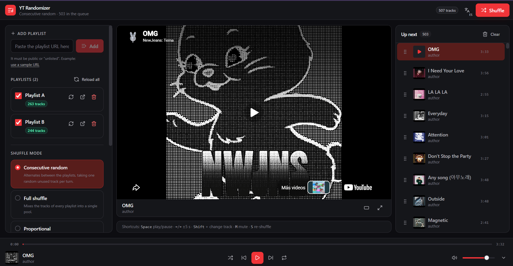

# YT Playlist Randomizer (Next.js)

**Dark** web app where you paste **YouTube** and **YouTube Music** playlist URLs, shuffle them
with the randomization mode of your choice, and play them with a full-featured player: an
"Up next" queue, a bottom bar with controls, a seekable progress bar, volume, repeat, shuffle,
and **drag & drop** to reorder the queue.

 
 


<p align="center">
  
</p>


## Getting started

```bash
npm install
```

The app needs a **YouTube Data API v3 key**. It lives in the `.env` file (see `.env.example`):

```bash
YOUTUBE_API_KEY=''
```

> **Important:** the key is server-only — never prefix it with `NEXT_PUBLIC_` (that would inline
> it into the client bundle). The browser only talks to our own `/api/playlist/:id` endpoint;
> it never calls Google directly and never sees the key. Restrict the key in Google Cloud by
> **server IP** (not HTTP referrer) and enable only *YouTube Data API v3*.

## Commands

```bash
npm run dev        # dev server (Turbopack)
npm run build      # production build
npm start          # serves the production build
npm run lint       # eslint
```

## Usage

1. Paste a playlist URL into the left panel. It must be **public or "unlisted"**.
   Valid example youtube  music: `https://music.youtube.com` or playlist url youtube: `https://www.youtube.com/watch?blabla&list=blabla`.
2. Enable or disable each playlist with its checkbox, rename it by clicking its name, and
   reload it with the refresh button.
3. Pick the **shuffle mode** and its options.
4. Hit **Shuffle** (or the `S` key) and press play.

### Keyboard shortcuts

| Shortcut | Action |
|---|---|
| `Space` | Play / pause |
| `←` / `→` | Seek back / forward 5 s |
| `Shift` + `←` / `→` | Previous / next track |
| `M` | Mute |
| `S` | Re-shuffle the queue |
| Media keys (play/pause, next, previous) | Same actions, also on the lock screen via Media Session |

## Shuffle modes

| Mode | What it does |
|---|---|
| **Consecutive random** | Rotates through playlists, picking one random unplayed song per turn. This is the main mode. |
| **Full shuffle** | Every song from every playlist in a single pool. |
| **Proportional** | Rotates while respecting each playlist's relative size (a small playlist doesn't always end up last). |
| **Sequential blocks** | Playlist by playlist, each one internally shuffled. |
| **No randomization** | Original order, concatenated. |

Options: **remove duplicates** (dedupes by `videoId` across playlists) and
**re-shuffle rounds** (changes the playlist order on every round).

## Architecture

```
src/
├─ app/
│  ├─ layout.tsx            # root layout (server): <html class="dark">, metadata, fonts
│  ├─ page.tsx              # server wrapper rendering <Providers><PlayerLayout /></Providers>
│  ├─ providers.tsx         # client providers: QueryClient, Tooltip, PlayerBridge, Toaster
│  └─ api/playlist/[id]/
│     └─ route.ts           # backend proxy: key + YouTube fetching, returns { tracks }
├─ lib/
│  ├─ youtube/
│  │  ├─ parseUrl.ts      # extracts `list=` (rejects RD mixes and "Liked" with a clear message)
│  │  ├─ api.ts           # shared/client: typed errors, itemsToTracks, backend fetch
│  │  ├─ server.ts        # server-only: API key + playlistItems/videos fetching
│  │  ├─ schemas.ts       # zod validation of API responses
│  │  ├─ cache.ts         # track cache in IndexedDB (idb-keyval)
│  │  └─ player.ts        # IFrame API types and player options
│  ├─ shuffle/            # fisherYates, consecutiveRandom, fullShuffle, proportional, blocks
│  ├─ time.ts             # m:ss and ISO 8601 duration parsing
│  ├─ mediaSession.ts     # Media Session API (media keys, lock screen)
│  └─ utils.ts
├─ store/
│  ├─ playlistsStore.ts   # metadata + shuffle options (persisted)
│  ├─ playlistsSelectors.ts
│  └─ playerStore.ts      # queue, current track, volume, repeat (persisted)
├─ hooks/                 # usePlaylistManager, useShuffleQueue, usePlayerBridge, useYouTubePlayer, useHotkeys
├─ components/
│  ├─ ui/                 # in-house components built on Radix
│  ├─ layout/ playlists/ player/ queue/
└─ i18n/                  # es.ts, en.ts, translate.ts, useT.ts
```

Key decisions:

- **The API key never leaves the server.** `src/lib/youtube/server.ts` (`import 'server-only'`)
  is the only module that reads `process.env.YOUTUBE_API_KEY`; the client calls
  `GET /api/playlist/:id`, which returns `{ tracks }` or `{ code }` with a mapped HTTP status.
- **`currentId` is the source of truth** for the player, not the index. Removing or moving
  queue items never desyncs what is playing.
- Tracks live in **IndexedDB** and only metadata goes in `localStorage`: a large playlist
  doesn't fit in `localStorage`'s ~5 MB.
- Persisted Zustand stores use `skipHydration` + rehydrate on mount, so the first client render
  matches the server prerender (no hydration mismatch).
- The queue is **virtualized** with `@tanstack/react-virtual` at a fixed 64 px height, which
  lets it combine with `@dnd-kit/sortable` without measurement conflicts.
- While dragging, only a **window of up to 62 rows (±30 around the pointer, plus the dragged
  row)** is mounted, via the virtualizer's `rangeExtractor`. Mounting the whole queue froze
  the drag: every row is a droppable that `dnd-kit` has to measure, collide against, and
  re-render on every auto-scroll tick. The `SortableContext` also receives only the mounted
  window, keeping the sorting strategy at O(window) instead of O(queue).
- The dragged row stays **pinned as a placeholder** (no transform while `isDragging`); the
  `DragOverlay` is what follows the pointer. Never put `contain` (layout or paint) or
  transforms on the queue panel or the mobile sheet: they would trap the `fixed` overlay and
  paint it off-screen instead of under the cursor.
- The queue persists with **batched writes that skip unchanged state**: the `persist`
  middleware serializes on every `set()`, and the playback clock alone fires several times
  per second, so ticks that keep the same `queue` reference never touch storage.
- Progress is polled on a 250 ms `setInterval`: the IFrame API emits no time events.
- `react-youtube` is loaded with `next/dynamic` (`ssr: false`) because it touches `window`
  on import.
- Videos rejected by the IFrame API (errors 100/101/150) are marked unavailable, announced
  with a toast, and skipped without interrupting playback.

## Known limitations

- **Auto mixes** (`list=RD…`) and the "Liked" list (`LL`) can't be read with the public
  API; the app explains this when you paste the URL.
- The video can't be hidden (YouTube's ToS don't allow it): it shows in the central panel,
  with cinema mode and fullscreen.
- Some browsers pause playback in background tabs; this is mitigated with the
  Media Session API.
- The API rate limit (60 req/min per IP) is in-memory per instance; a multi-instance
  deployment needs a shared store.

### 📄 License

This project is licensed under the MIT License - see the [LICENSE](LICENSE) file for details.

---

## 👨‍💻 Author / Autor

**Diego Ivan Perea Montealegre**

- GitHub: [@diegoperea20](https://github.com/diegoperea20)

---

Created by [Diego Ivan Perea Montealegre](https://github.com/diegoperea20)
